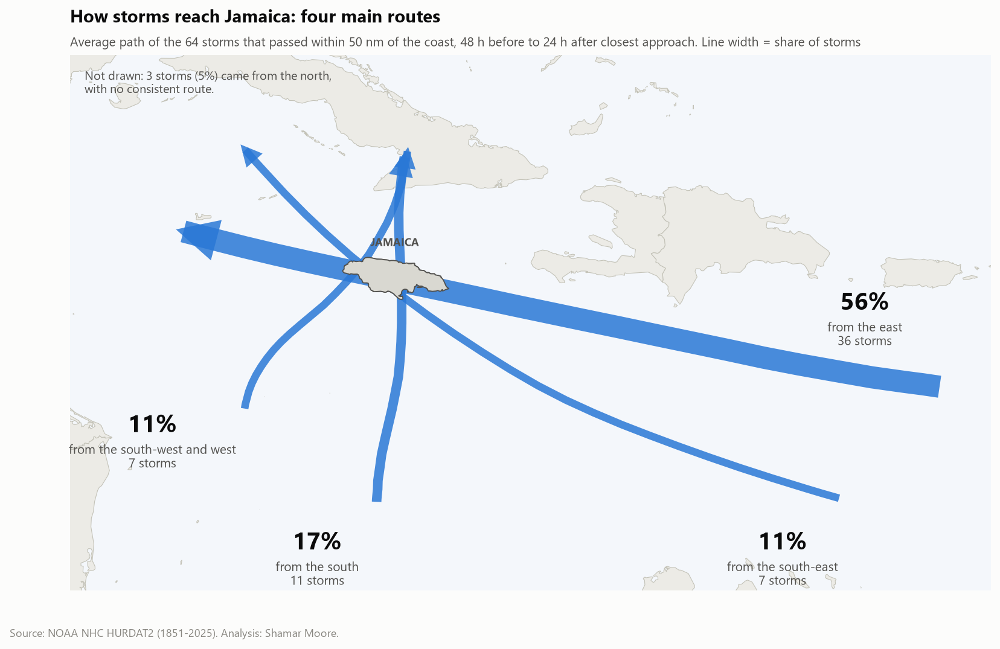
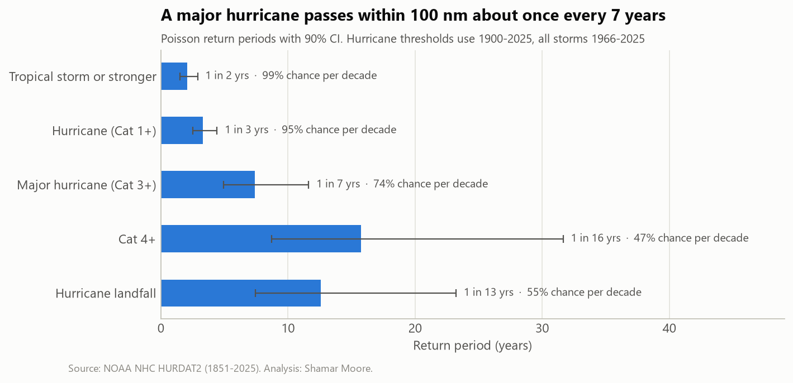
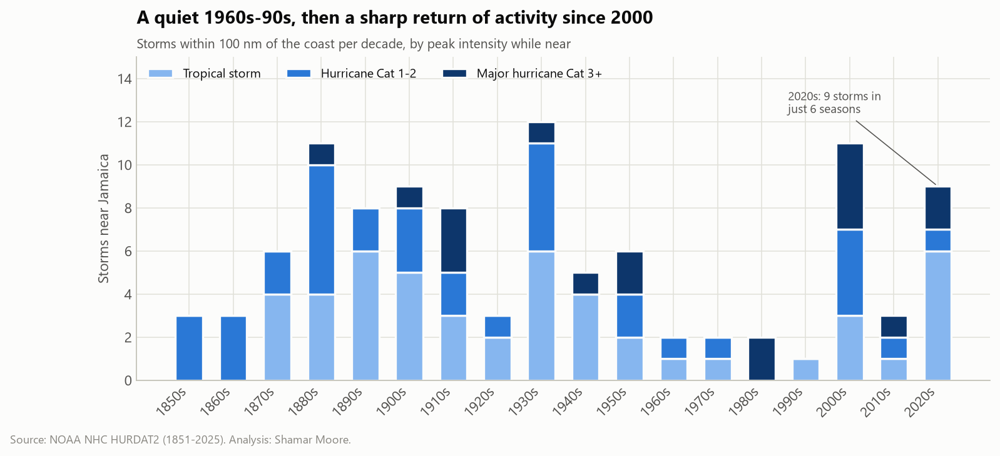
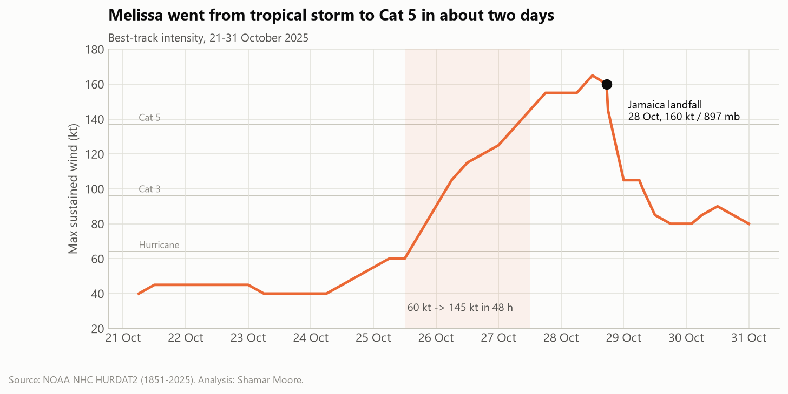
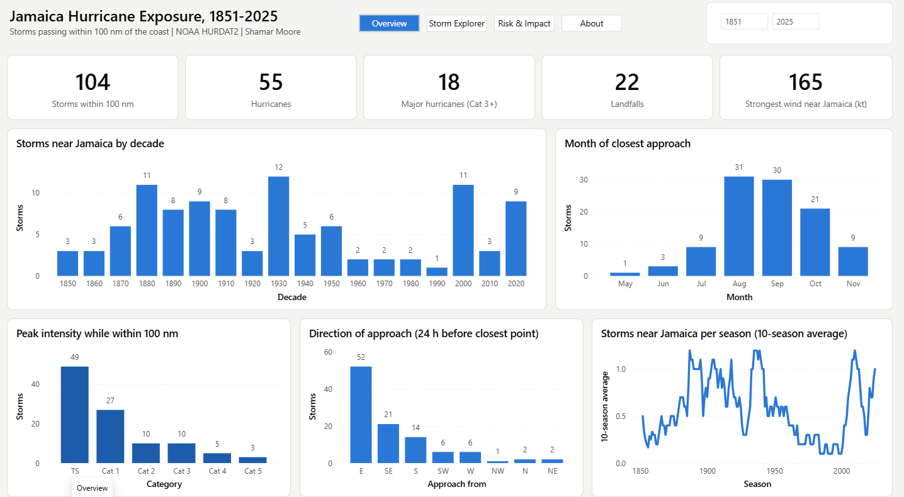
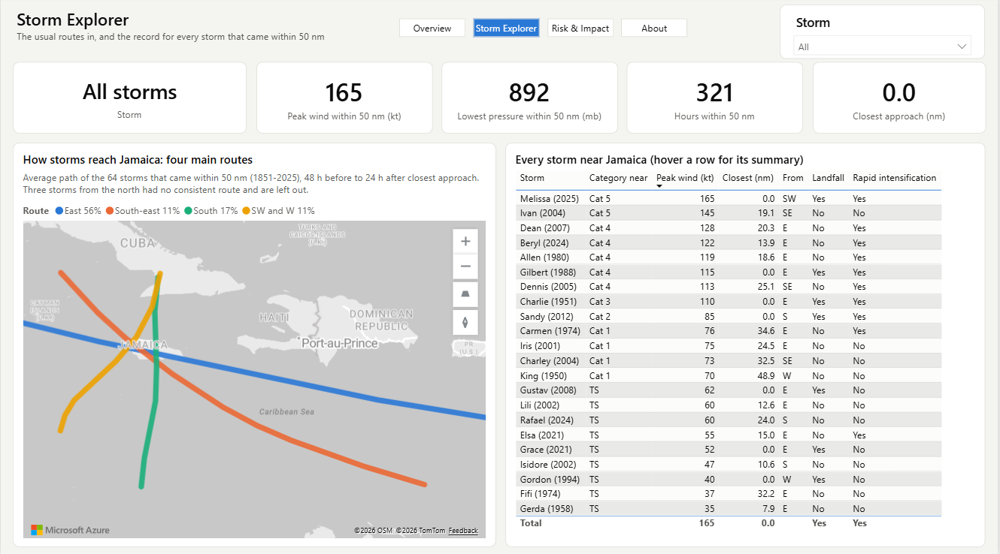

# Hurricanes and Jamaica: 175 years of storm tracks

I'm not a meteorologist. I work with data, and I've always been interested in what storms do to Jamaica: how often they come, which way they come from, and why some years hurt far more than others. Hurricane Melissa in October 2025 turned that interest into this project.

Everything here comes from public records. NOAA's best-track archive covers every Atlantic storm since 1851. I rebuilt it around Jamaica's coastline and joined it to damage figures from the Planning Institute of Jamaica, ECLAC and the World Bank. Then I asked a few plain questions and followed the numbers, including where they contradicted what I expected.



## What I found

**1. 64 storms have passed within 50 nautical miles of the coast since 1851.** That counts only storms at tropical-storm strength or above. 33 were hurricanes while that close, 12 were major hurricanes (Category 3 or higher), and 22 made landfall.

**2. Most storms arrive from the east.** 56% came from the east, riding the trade winds across the Caribbean. 17% came up from the south, 11% from the south-east and 11% from the south-west or west. The map above shows the average route for each direction. The southern and south-western routes are the ones to watch. Sandy (2012) and Melissa (2025) both came that way in October and hit the south coast, where most people live.

**3. A major hurricane comes within 50 nm about once every 10 years.** Using 1900 to 2025, that works out to a 61% chance in any given decade. A hurricane of any category comes this close about once every 5 years, and a hurricane makes landfall about once every 13.



**4. Activity since 2000 is almost four times what it was from 1966 to 1999.** From 2000 to 2025 there were 0.54 storms near Jamaica per season, against 0.15 in the quiet stretch before. The 2020s already have 5 storms in six seasons. I expected this to be a long-term trend, but it isn't. From 1900 onward there is no trend at all, because the 1930s were busier than the 2000s. The quiet decades were the unusual part, and a lot of today's planning dates from them.



**5. The typical hurricane isn't stronger, but the worst ones are.** The median hurricane near Jamaica since 2000 is about as strong as before. Both storms that reached Category 5 strength within 50 nm, Ivan (2004) and Melissa (2025), came after 2000. With 13 hurricanes in the comparison, that's a pattern to watch, not proof.

**6. El Niño and La Niña make little difference this close in.** I expected La Niña years to bring more storms, since La Niña weakens the wind shear that tears storms apart. Within 100 nm it does show up, at about 2.4 times the El Niño rate (p = 0.08). Within 50 nm it disappears: 0.28 storms per season in La Niña years against 0.25 in El Niño years (p = 0.87).

**7. Melissa cost more than half of Jamaica's GDP.** The PIOJ and ECLAC assessment puts damage and loss at US$12.2 billion, 56.7% of 2024 GDP. That's about six times the combined cost of all nine assessed storms from 2001 to 2024. Melissa went from 60 knots to 145 knots in 48 hours, made landfall at 160 knots, and crossed the island at about 8 knots, slower than the 14-knot median for hurricanes near Jamaica.



**8. Rain reaches further than wind.** Nicole (2010) and Michelle (2001) never came within 250 nm, yet each caused losses close to those of hurricanes that passed just offshore. Below the catastrophic storms, wind speed and distance explain little of the cost. Flooding and landslides need their own planning.

**9. A simple model gives earlier warning than a straight line.** I trained a model to answer one question for a storm 150 to 600 nm away: will it pass within 50 nm in the next 72 hours? It uses only the storm's current position, motion and strength. On storms from 2015 to 2025, which it never saw in training, a logistic regression scored an average precision of 0.53, against 0.45 for extending the storm's current path in a straight line. Gradient boosting looked better on that holdout, but only 15 positive cases back that score, and it did worse in cross-validation. I kept the simpler model. It doesn't replace the National Hurricane Center's forecasts, which use full weather models.

## How I did it

**I measured distance to the coastline, not to the middle of the island.** Jamaica is about 235 km long. A circle around its centre misses storms that clip the eastern or western end. I used the Natural Earth 1:10m coastline and a haversine BallTree from scikit-learn.

**I filled in the gaps between track points.** NOAA records a storm's position every six hours, and a fast storm can cover 100 nm in that time. I interpolated every track to hourly positions before working out closest approach, time near the island and landfall.

**I counted storms, not track points.** My first Power BI version of this counted every six-hourly record, which overcounts slow storms. Each storm is now one row with its own summary.

**I separated the reliable years from the rest.** Satellites started watching in 1966 and aircraft reconnaissance in 1944. Hurricane statistics use 1900 onward, all-storm statistics use 1966 onward, and I treat wind speeds before 1950 as rough.

**The statistics are deliberately plain.** Trend and ENSO comparisons use Poisson regression. Return periods use exact Poisson intervals, intensity comparisons use a Mann-Whitney test, and uncertainty bands come from bootstrapping. The model uses grouped cross-validation, so no storm appears in both training and testing, plus a strict time split.

**The routes on the map are averages.** I grouped storms by where they were 24 hours before their closest approach, lined their tracks up on that moment, and averaged positions hour by hour. Three storms came from the north with no shared route, so the map leaves them out and says so.

## Power BI report

`powerbi/JamaicaHurricanes.pbip` is a Power BI Project. The model and report are plain text files, so changes show up line by line in Git.



The report has four pages:

- **Overview.** Headline counts, storms by decade, month, strength and direction, and a 10-season rolling average.
- **Storm Explorer.** The four main routes on a map, and a table of every storm that came within 50 nm. Hovering a storm shows a short summary of it.
- **Risk & Impact.** Return periods and decade odds that recalculate for whatever seasons you select, storms per season by ENSO phase, and damage as a share of GDP.
- **About.** Sources, definitions and the data model.



The model is a star schema with 7 dimension tables and 4 fact tables:

```
Dim ENSO Phase ─▶ Dim Season ─▶ Dim Storm ─┬─▶ Fact Storm Approach ◀─ Dim Date, Dim Category,
                                           │                          Dim Direction, Dim Distance Band
                                           ├─▶ Fact Track Point    ◀─ Dim Date, Dim Category
                                           └─▶ Fact Impact

Fact Pathway Point (standalone: the averaged routes for the map)
```

Every relationship is one-to-many and filters in one direction, and `Dim Date` is marked as the date table. The 52 DAX measures live in a `_Measures` table, grouped into display folders. Implicit measures are turned off, so every number on a page comes from a named measure.

One parameter, `DataSource`, feeds every query through a shared `fnGetCsv` function. By default it points at this repository's raw GitHub address (`https://raw.githubusercontent.com/shamarmoore/jamaica-hurricane-analysis/main/data/processed/`), so the report refreshes anywhere, including the Power BI Service, without a gateway. To work from a local copy, set it to a folder path ending in a backslash.

To open the report:

1. Install Power BI Desktop and open `powerbi/JamaicaHurricanes.pbip`.
2. To use a local copy of the data, go to **Transform data** > **Edit parameters** and change `DataSource`.
3. Click **Refresh**.

## Run the analysis yourself

```bash
python -m venv .venv
.venv\Scripts\activate
pip install -r requirements.txt
python scripts/build_dataset.py --refresh
jupyter lab notebooks/
```

On macOS or Linux, activate the environment with `source .venv/bin/activate` instead. `build_dataset.py --refresh` downloads the latest HURDAT2 and ONI files. Without `--refresh` it uses the copies in `data/raw/`.

| Notebook | Covers |
|---|---|
| `01_data_pipeline_and_eda.ipynb` | Definitions, routes into Jamaica, seasonality, strength |
| `02_trends_enso_return_periods.ipynb` | Trends by decade, intensity over time, ENSO, return periods |
| `03_economic_impact_and_melissa.ipynb` | Damage and loss, what drives cost, Melissa in context |
| `04_approach_risk_model.ipynb` | The 72-hour early-warning model and its limits |

```
├── data
│   ├── raw/                 HURDAT2, ONI, coastline, impact table with sources
│   └── processed/           tables the notebooks and Power BI read
├── notebooks/               the four notebooks above
├── powerbi/                 Power BI Project (TMDL model and report)
├── reports/
│   ├── figures/             charts from the notebooks
│   └── powerbi/             screenshots of the report
├── scripts/build_dataset.py downloads and processes everything
└── src/jhurricane/          parsing, geometry, features, model, plotting
```

## Data sources

| Source | Used for |
|---|---|
| [NOAA NHC HURDAT2](https://www.nhc.noaa.gov/data/#hurdat), Atlantic, 1851 to 2025 (September 2026 release) | Storm tracks, wind, pressure, landfall points |
| [NOAA CPC Oceanic Niño Index](https://www.cpc.ncep.noaa.gov/data/indices/oni.ascii.txt) | El Niño and La Niña phase for each season |
| [Natural Earth](https://www.naturalearthdata.com/) 1:10m countries | Jamaica's coastline and the base map |
| [PIOJ](https://www.pioj.gov.jm/), ECLAC, [World Bank and IDB](https://www.worldbank.org/en/news/press-release/2025/11/19/world-bank-idb-estimate-hurricane-melissa-damage-to-jamaica-totals-all-time-high-of-us-8-8-billion), [CDKN (2014)](https://cdkn.org/sites/default/files/files/Floods-and-DRM-in-Jamaica-_with-policies_final.pdf), [JIS](https://jis.gov.jm/total-loss-and-damage-from-hurricane-melissa-estimated-at-1-952-trillion/) | Damage, loss and deaths. Each figure's source is in `data/raw/jamaica_storm_impacts.csv` |

## What this can't tell you

- The damage figures come from different studies using different methods. Melissa's US$12.2 billion includes economic losses. The World Bank's US$8.8 billion covers physical damage only. Gilbert's share of GDP comes from an older estimate.
- "Peak wind within 50 nm" measures how strong a storm was near the island, not the wind people felt on land.
- Storm records before satellites are incomplete. Weak storms over open water before 1966 were sometimes missed.
- The model doesn't know about steering winds or forecast models. Treat it as a screening tool.

## What I'd look at next

- Rainfall. Nicole and Michelle show that rain drives a large share of losses, and NOAA's rainfall archives could test that properly.
- Damage by parish, to see which parts of the island each route puts at risk.
- Storm surge on the south coast, where the southern routes make landfall.

## License

MIT. The data stays under its providers' terms. NOAA data is public domain.
