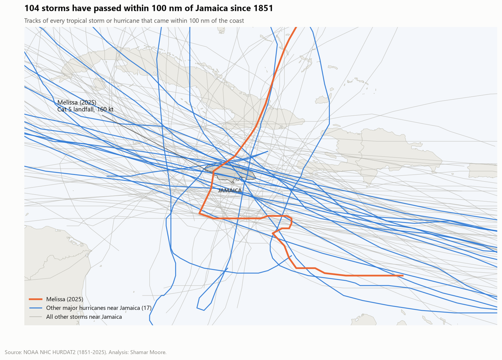

# Jamaica Hurricane Exposure, 1851–2025

How often do tropical cyclones threaten Jamaica, is that changing, and what made Hurricane Melissa (2025) so destructive?

This project rebuilds NOAA's 175-year Atlantic best-track record around Jamaica's coastline. It covers trends, ENSO effects and return periods, joins the meteorology to assessed economic losses, and trains a small model that flags storms likely to pass close to the island. Results are in Jupyter notebooks and a Power BI report.



## Key findings

| | |
|---|---|
| **104 storms** | have passed within 100 nm of the coast at tropical-storm strength or above since 1851. 55 were hurricanes, 18 were major hurricanes, and 22 made landfall. |
| **1 in 7 years** | is the return period for a major hurricane within 100 nm (1900–2025). That's roughly a 74% chance in any decade. For a hurricane of any category it's about 1 season in 4. |
| **5× busier** | 2000–2025 averaged 0.88 storms near Jamaica per season, against 0.18 in the quiet 1966–1999 stretch. The 2020s have already logged 9 storms in six seasons. There is no trend since 1900, though: the 1880s and 1930s were just as active. |
| **Heavier tail** | The *typical* hurricane near Jamaica isn't stronger than it used to be. But all three storms that reached Cat 5 strength within 100 nm (Ivan 2004, Emily 2005, Melissa 2025) came after 2000. |
| **La Niña ≈ 2.4×** | La Niña Aug–Oct seasons have brought about 2.4× as many storms near Jamaica as El Niño seasons (p ≈ 0.08, so suggestive rather than conclusive). |
| **US$12.2bn** | Melissa's assessed damage and loss (PIOJ/ECLAC) came to 56.7% of 2024 GDP, about 6× the combined cost of all nine assessed storms from 2001 to 2024. It made landfall at 160 kt / 897 mb after going from 60 kt to 145 kt in 48 hours, then spent 83 hours within 100 nm. |
| **Rain travels** | Nicole (2010) and Michelle (2001) never came within 250 nm, yet each caused losses comparable to hurricanes passing just offshore. |
| **Model** | Using only a storm's current position, motion and intensity, a logistic regression flags storms that will pass within 100 nm in the next 72 h with average precision of 0.64 on 2015–2025 storms, against 0.57 for straight-line extrapolation. Gradient boosting didn't beat it. |

## Project structure

```
├── data
│   ├── raw/                 HURDAT2, ONI, coastline, curated impact table (with sources)
│   └── processed/           storms, seasons, track points, impacts (feeds notebooks + Power BI)
├── notebooks
│   ├── 01_data_pipeline_and_eda.ipynb
│   ├── 02_trends_enso_return_periods.ipynb
│   ├── 03_economic_impact_and_melissa.ipynb
│   └── 04_approach_risk_model.ipynb
├── powerbi/                 Power BI Project (PBIP): TMDL semantic model + report
├── reports/figures/         every chart used in the notebooks and the README
├── scripts/build_dataset.py downloads + processes everything
└── src/jhurricane/          parsing, geometry, features, model, plotting
```

## Method

**Distance to coast, not to a centre point.** Jamaica is about 235 km long, so a radius around its centre undercounts storms that clip either end. I measure distance to the Natural Earth 1:10m coastline using a haversine BallTree.

**Hourly interpolation.** Best-track fixes are six hours apart, and a fast storm can cover 100 nm in that time. Tracks are interpolated to hourly positions before computing closest approach, time within 100 nm, and landfall.

**One row per storm.** Summary metrics are computed per storm, not per track point. Counting 6-hourly fixes, as my first version of this dashboard did, inflates totals for slow storms.

**Data-quality eras.** Satellite coverage starts in 1966 and aircraft reconnaissance in 1944. Hurricane-strength statistics use 1900 onward, all-storm statistics use 1966 onward, and pre-1950 intensities are treated as approximate.

**Statistics.** Poisson GLMs for frequency trends and ENSO rate ratios, exact Poisson intervals for return periods, bootstrap CIs, and Mann-Whitney for intensity shifts.

**Model.** Each training row is a storm's state at a 6-hourly fix while it is 150–600 nm from the coast (4,217 rows, 429 storms, 1950–2025). The label is whether the actual track came within 100 nm in the next 72 hours. Rows from the same storm are highly correlated, so I use grouped cross-validation by storm plus a strict time holdout (train ≤ 2014, test 2015–2025).

## Power BI report

`powerbi/JamaicaHurricanes.pbip` is a Power BI Project, so the model and report are plain text and diff cleanly in Git.


**Semantic model (star schema).**

```
Dim ENSO Phase ─▶ Dim Season ─▶ Dim Storm ─┬─▶ Fact Storm Approach ◀─ Dim Date, Dim Category,
                                           │                          Dim Direction, Dim Distance Band
                                           ├─▶ Fact Track Point    ◀─ Dim Date, Dim Category
                                           └─▶ Fact Impact
```

* 7 dimensions and 3 fact tables. Every relationship is single-direction many-to-one with no ambiguous paths. `Dim Date` is marked as the date table.
* 28 DAX measures in a dedicated `_Measures` table, grouped in display folders (Counts, Intensity, Rates, Impact, Track, Labels). Implicit measures are disabled.
* Fact keys are hidden, sort-by columns are set for month, category, direction and ENSO phase, and columns carry descriptions.
* One parameter, `DataSource`, drives every query through a shared `fnGetCsv` function. Point it at a local folder, or at this repo's raw GitHub URL (`https://raw.githubusercontent.com/shamarmoore/jamaica-hurricane-analysis/main/data/processed/`), and refresh.

**Pages.** Overview · Storm Explorer (pick any storm, see its track, intensity and closest approach) · Risk & Impact (return periods, ENSO, damage) · About. A navigation bar runs across the top of every page.

To open it, install Power BI Desktop, open the `.pbip`, set **Transform data → Edit parameters → DataSource** if your path differs, then **Refresh**.

## Reproduce

```bash
python -m venv .venv
.venv\Scripts\activate          # or: source .venv/bin/activate
pip install -r requirements.txt
python scripts/build_dataset.py --refresh
jupyter lab notebooks/
```

## Data sources

| Source | Used for |
|---|---|
| [NOAA NHC HURDAT2](https://www.nhc.noaa.gov/data/#hurdat), Atlantic, 1851–2025 (23 Sep 2026 release) | Storm tracks, intensity, landfall fixes |
| [NOAA CPC Oceanic Niño Index](https://www.cpc.ncep.noaa.gov/data/indices/oni.ascii.txt) | ENSO phase per season |
| [Natural Earth](https://www.naturalearthdata.com/) 1:10m admin-0 | Jamaica coastline, basemap |
| [PIOJ](https://www.pioj.gov.jm/), ECLAC, [World Bank / IDB](https://www.worldbank.org/en/news/press-release/2025/11/19/world-bank-idb-estimate-hurricane-melissa-damage-to-jamaica-totals-all-time-high-of-us-8-8-billion), [CDKN (2014)](https://cdkn.org/sites/default/files/files/Floods-and-DRM-in-Jamaica-_with-policies_final.pdf), [JIS](https://jis.gov.jm/total-loss-and-damage-from-hurricane-melissa-estimated-at-1-952-trillion/) | Damage and loss, deaths (see `data/raw/jamaica_storm_impacts.csv`) |

## Limitations

* Damage figures come from different assessment methods and years. Melissa's PIOJ/ECLAC figure includes losses, while the World Bank's US$8.8bn covers physical damage only. Gilbert's % of GDP rests on an older ECLAC-based estimate.
* "Intensity within 100 nm" is a measure of threat, not of winds felt on land. A storm can peak on the far side of the ring.
* The model has no steering-flow or forecast-guidance inputs. It is a screening tool, not a forecast.

## License

MIT. Data remains under the terms of its original providers (NOAA data is public domain).
